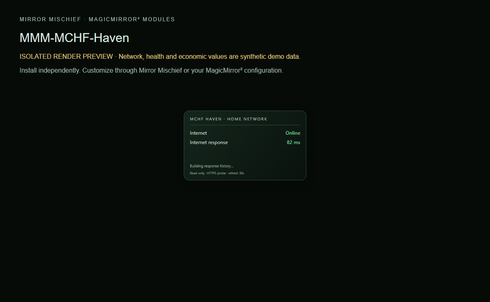

# MMM-MCHF-Haven

Internet response history with optional private network telemetry.

**MCHF means Mischief.** Part of [Mirror Mischief](https://github.com/FoggEyez/Mirror-Mischief). Install and configure manually, or use the optional companion.



Screenshot uses the actual module renderer in an isolated preview. Network/health/economy readings are labelled synthetic demonstration data, not live readings.

## Install

Requires a working MagicMirror² installation, Node.js 22 or newer, and a current browser. Development baseline: MagicMirror² 2.38.0 API. Physical-device compatibility of this newly packaged version remains to be verified; see VALIDATION.md.

```sh
cd ~/MagicMirror/modules
git clone https://github.com/FoggEyez/MMM-MCHF-Haven.git
```

No npm runtime dependencies or install scripts. No extra services are required.

Add this to the modules array in config/config.js, then restart MagicMirror²:

```js
{
  module: "MMM-MCHF-Haven",
  position: "top_right",
  config: {}
}
```

## Customize

Works immediately with `internetUrl`. For richer router/gateway data, set `snapshotFile` to an absolute path written atomically by your own trusted collector. It must be version 1 JSON with observedAt (epoch milliseconds), internet {ok,ms}, and optional routerReachable, model, clients and gateway data. The collector is not bundled; no router model, password, SSH host or Windows service is assumed. A configured snapshot replaces the built-in internet probe. Missing/stale/invalid input remains unavailable. See examples/network-snapshot.json for the optional format. Never put router credentials in snapshots.

All supported settings are visible as literal defaults for generated settings editors.

| Setting | Default | Type |
| --- | --- | --- |
| snapshotFile | `""` | string |
| internetUrl | `"https://example.com/"` | string |
| pollSeconds | `30` | number |
| routerLabel | `"Router"` | string |
| gatewayLabel | `"Gateway"` | string |
| panelWidth | `350` | number |
| showHistory | `true` | boolean |
| showDeviceBreakdown | `true` | boolean |
| showTrafficStatus | `true` | boolean |
| showTrafficGraph | `true` | boolean |
| showTrafficTotals | `true` | boolean |
| staleSeconds | `120` | number |

## Mirror Mischief companion

Part of [Mirror Mischief](https://github.com/FoggEyez/Mirror-Mischief), a companion designed to make module installation, settings and layout easier. See [MIRROR-MISCHIEF.md](MIRROR-MISCHIEF.md) for setup and availability.

In Mirror Mischief, choose Install from a link, paste this repository URL, then open Module settings. Set your preferences and position, save and run Check setup. The repository folder, JavaScript entry and Module.register name match exactly. companion.json describes supported placement and dependencies; the current companion reads defaults from JavaScript, not this manifest. One instance per mirror is supported in this release; helpers share one configuration per module. For renamed legacy modules, install this version turned off first and disable the legacy counterpart before enabling it. All public modules now use MMM-MCHF names, including Luna and Wit. GitHub redirects do not rename installed folders or config entries. Keep a configuration backup, install the newly named folder, transfer supported settings and disable the earlier counterpart before enabling its replacement. No automatic config migration or removal occurs. Ordinary MagicMirror² configuration works without the companion.

## APIs, privacy and cost

Default: one HTTPS HEAD request to [example.com](https://example.com/) every 30 seconds (15–600 configurable). No account or key. You can choose another HTTPS URL that supports HEAD. It measures HTTP response time, not bandwidth or ISP latency. No router access occurs by default.

No telemetry or analytics is added by Mischief. Keep private configuration, tokens and collector snapshots outside this repository.

## Update or remove

Review CHANGELOG.md, back up your private config and local customizations, then run git pull --ff-only inside this module folder and restart MagicMirror². To remove, disable/remove its config entry and restart; retain the folder for rollback or uninstall it using your companion. Never overwrite private configuration from an example.

## Development and support

Run npm ci and npm test. See CONTRIBUTING.md and VALIDATION.md. Report reproducible issues through this repository's Issues tab; remove secrets and private addresses.

## Credits and license

Original Mischief implementation. Optional telemetry comes from a collector you control; provider/router integrations are not included.

Original Mischief code: MIT, Copyright 2026 FoggEyez. Third-party licenses and data credits remain applicable; see THIRD_PARTY_NOTICES.md.

## Help and troubleshooting

See [TROUBLESHOOTING.md](TROUBLESHOOTING.md) for common states and setup checks. [Open an issue](https://github.com/FoggEyez/MMM-MCHF-Haven/issues) with a minimal configuration that has secrets removed.
